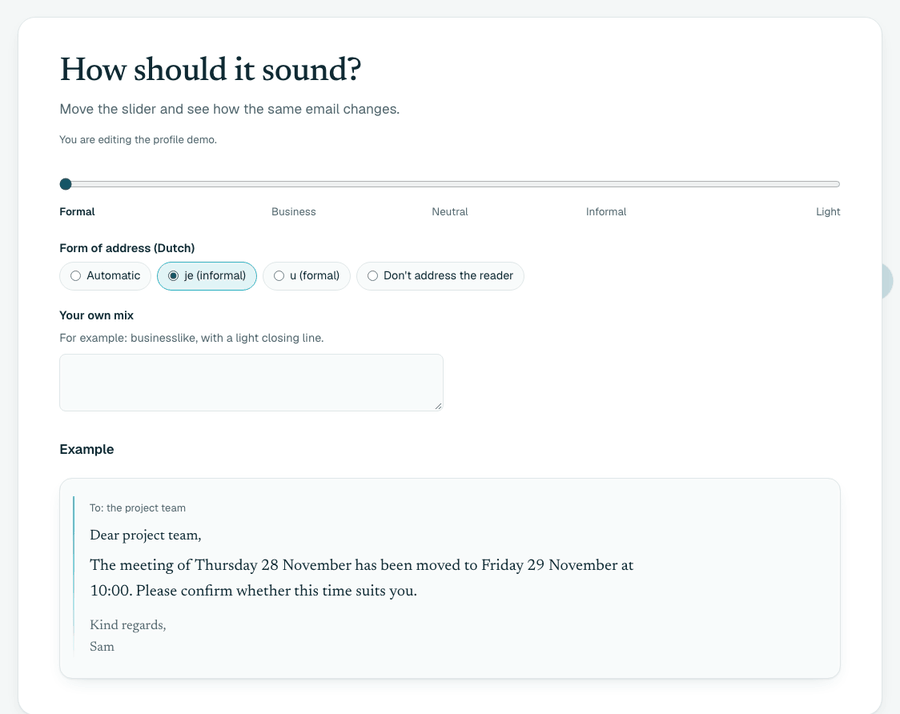
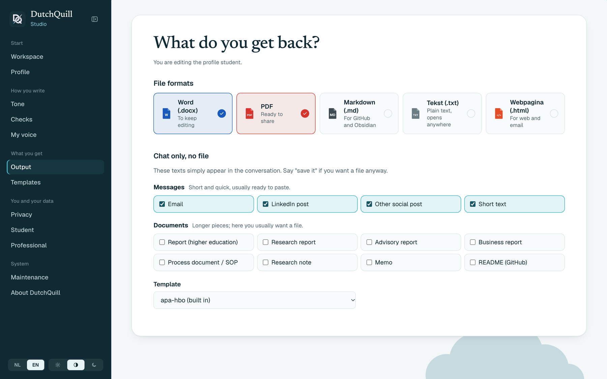

<p align="right"><a href="README.md">🇳🇱 Nederlands</a> · <b>🇬🇧 English</b></p>

<p align="center"></p>

<p align="center">
  <a href="https://github.com/nickyjacobs/DutchQuill-AI/releases/latest"></a>
  <a href="https://github.com/nickyjacobs/DutchQuill-AI/actions/workflows/ci.yml"></a>
  
  
  <a href="LICENSE"></a>
</p>

<p align="center"><b>Write, rewrite, review and humanize in Claude Code.<br>Dutch first, fully capable in English, in your own voice.</b></p>

<p align="center">
  <a href="#install">Install</a> ·
  <a href="#what-you-can-do">What you can do</a> ·
  <a href="#dutchquill-studio">Studio</a> ·
  <a href="#humanizing-honestly">Humanizing</a> ·
  <a href="docs/en/README.md">Documentation</a> ·
  <a href="#the-story">The story</a>
</p>

DutchQuill is a writing assistant for Claude Code. It writes, rewrites, reviews and humanizes your texts: an
academic report, a process document, an email, a LinkedIn post or a README. You decide what it checks, how it
sounds and in which format you get it back.

<p align="center"></p>

## Install

In Claude Code (2.1.275 or later):

```text
/plugin marketplace add nickyjacobs/DutchQuill-AI
/plugin install dutchquill@dutchquill
```

Then type `/dutchquill:instellen` ("set up") and choose: DutchQuill Studio in your browser, or a few questions in the
chat. Needed: Python 3.10 or later, or [uv](https://docs.astral.sh/uv/). Step by step:
[Getting started](docs/en/guide/getting-started.md).

## What you can do

The commands have Dutch names; plain English works just as well.

| Command | What it does |
|---|---|
| `/dutchquill:schrijven` | Write a new text, from your question or the material in your workspace |
| `/dutchquill:herschrijven` | Improve, shorten, make more formal or lighter, translate NL↔EN, without changing a single fact |
| `/dutchquill:reviewen` | Check language, structure, tone, AI patterns and (when switched on) APA and your course rubric |
| `/dutchquill:humaniseren` | Remove AI patterns, in your own voice; or just scan |
| `/dutchquill:instellen` | Workspace, profiles, checks, tone, templates and privacy, visually or in the chat |
| `/dutchquill:bijwerken` | Check the reference guides against their sources (you get a reminder once a month) |

You don't need to remember the commands: "write an email to Sam saying I'll start later on Friday" or "does this
sound like AI?" works too. Emails and posts appear in the chat; documents go to your
[workspace](docs/en/guide/workspace.md), per title and per version, as Word, PDF, Markdown, text or HTML.

<picture>
  <source media="(prefers-color-scheme: dark)" srcset="docs/img/zo-werkt-het-en-donker.png">
  
</picture>

## DutchQuill Studio

A page in your browser that only runs on your own computer. There you choose your workspace, profile, tone, checks,
output and templates, without a single line of YAML, and nothing is saved before you have seen the overview. More:
[The Studio](docs/en/guide/studio.md).

<p align="center">
  
  
</p>

## Humanizing, honestly

DutchQuill makes text better and more personal: in your own voice (measured from your own texts), without the AI
patterns of 2026, specific instead of vague, and with a fact check after every round so that no number, name or
source disappears or appears. DutchQuill does not promise that a text is "invisible" to AI detectors and does not
change metadata to hide anything. More: [Humanizing](docs/en/guide/humanizing.md).

<p align="center"></p>

## What DutchQuill runs and fetches

- Your texts stay on your computer and in your conversation with Claude.
- A small Python hook at the start of a session: a one-time notice and one reminder per month.
- The first time, DutchQuill installs its Python packages (PyPI) in the plugin's data folder.
- The online language check (LanguageTool) is off by default; switched on, your text goes to api.languagetool.org.
- `/dutchquill:bijwerken` only fetches public pages (Scribbr NL, Wikipedia, GitHub), and only when you ask.
  DutchQuill Studio runs on 127.0.0.1, with a one-time key.

## Documentation

The starting point is [docs/en/README.md](docs/en/README.md).

- **Guide:** [getting started](docs/en/guide/getting-started.md), [workspace](docs/en/guide/workspace.md),
  [Studio](docs/en/guide/studio.md), [profiles and tone](docs/en/guide/profiles-and-tone.md),
  [templates](docs/en/guide/templates.md), [humanizing](docs/en/guide/humanizing.md), [FAQ](docs/en/guide/faq.md),
  [privacy](docs/en/privacy.md)
- **Reference:** [configuration](docs/en/reference/configuration.md), [commands](docs/en/reference/commands.md),
  [guides and sources](docs/en/reference/guides-and-sources.md)
- **Project:** [development](docs/en/project/development.md), [releasing](docs/en/project/releasing.md),
  [roadmap](ROADMAP.en.md), [changelog](CHANGELOG.md) (Dutch)

## The story

<p align="center"></p>

DutchQuill started at university. My reports had to follow APA and meet an academic standard, and I wanted to know
exactly what that meant. It turned into quite a rabbit hole, from margins and title pages to hanging indents. What
started as a Word template became an assistant for everything I write: reports, emails, LinkedIn posts and READMEs.
It may look like a tool for someone who wants everything to be easy, and that's partly true 😉 But mostly, I learned
a lot from it. [Read the whole story](docs/en/story.md).

*Nicky Jacobs*

## Feedback

A bug or an idea? Open an [issue](https://github.com/nickyjacobs/DutchQuill-AI/issues/new/choose) or start a
[discussion](https://github.com/nickyjacobs/DutchQuill-AI/discussions), in English or Dutch. Build along:
[CONTRIBUTING.md](CONTRIBUTING.md).

## License

[MIT](LICENSE) © Nicky Jacobs
