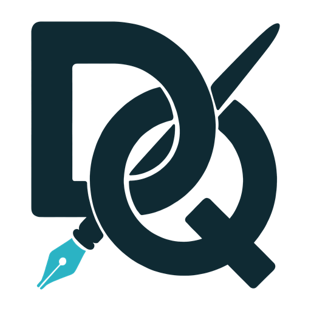

<p align="center">
  <picture>
    <source media="(prefers-color-scheme: dark)" srcset="assets/logo-donker.png">
    
  </picture>
</p>

# DutchQuill AI

A writing assistant for Claude Code, Dutch first and fully capable in English. DutchQuill writes, rewrites,
reviews and humanizes your texts: an academic report, a process document, an email, a LinkedIn post or a README.
You decide what it checks, how it sounds and in which format you get it back.

*Nederlands: zie [README.md](README.md).*


## Install

In Claude Code (2.1.275 or later):

```text
/plugin marketplace add nickyjacobs/DutchQuill-AI
/plugin install dutchquill@dutchquill
```

Then type `/dutchquill:instellen` ("set up"). Choose DutchQuill Studio in your browser (a local page, nothing goes
to the internet) or a few questions in the chat. The first run installs DutchQuill's Python packages into the
plugin's data folder, which takes about a minute.

**Needs:** Python 3.10+ or [uv](https://docs.astral.sh/uv/). **For PDFs:** LibreOffice (best), or Google Chrome or
Microsoft Edge; without them DutchQuill makes a simple PDF.

## What it does

| Command | What it does |
|---|---|
| `/dutchquill:schrijven` | Write new text from your request or the material in your workspace |
| `/dutchquill:herschrijven` | Improve, shorten, change the tone, translate NL↔EN, without changing a fact |
| `/dutchquill:reviewen` | Review language, structure, tone, AI patterns and, when switched on, APA and your course rubric |
| `/dutchquill:humaniseren` | Remove AI patterns in your own voice, or just scan |
| `/dutchquill:instellen` | Workspace, profiles, checks, tone, templates and privacy, visually or in the chat |
| `/dutchquill:bijwerken` | Check the reference guides against their sources (monthly reminder) |

Plain requests work too: "write a LinkedIn post about...", "does this sound like AI?".

Emails, posts and short texts appear in the chat. Documents go to your workspace, per title and per version, in
the formats you choose: Word, PDF, Markdown, text or HTML.

## Profiles, checks and tone

Built-in profiles (student, zakelijk/business, social, techniek/technical) are starting points. Every check (APA,
academic style, language, humanizing) switches on or off, tone has five levels plus a free-text mix, and you can
create your own profiles that build on another one. Full reference: [docs/configuratie.md](docs/configuratie.md)
(Dutch).

## Humanizing, honestly

DutchQuill makes text better and more personal:

- your own voice, measured from texts you wrote;
- the 2026 AI tells in Dutch and English;
- specific rather than vague;
- a fact check after every rewrite. It never invents facts, numbers or sources.

It does not promise that text is "undetectable" and does not alter document metadata to hide anything. If you use
AI for coursework, follow your programme's rules; DutchQuill helps with disclosure and APA citations (September 2025
format).

## Privacy

Your texts stay on your computer and in your conversation with Claude. The online grammar check (LanguageTool) is
off by default. `/dutchquill:bijwerken` only fetches public pages (Scribbr NL, Wikipedia, GitHub) when you run it.
The Studio runs on 127.0.0.1 only, with a one-time key.

## License

MIT. See [LICENSE](LICENSE).
