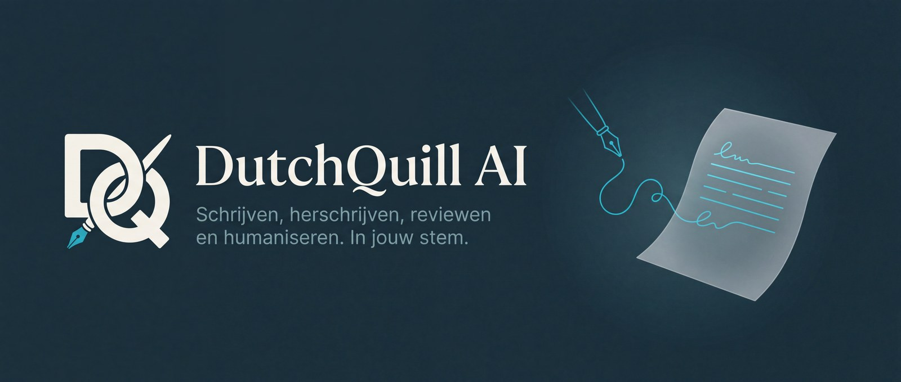
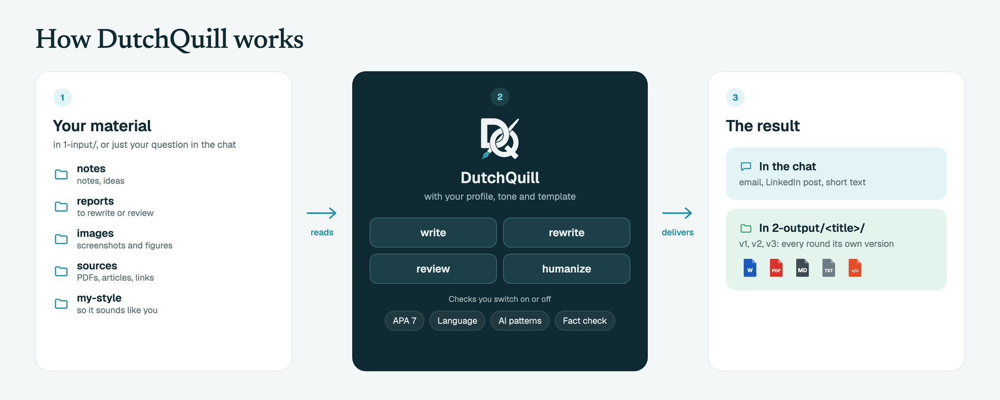
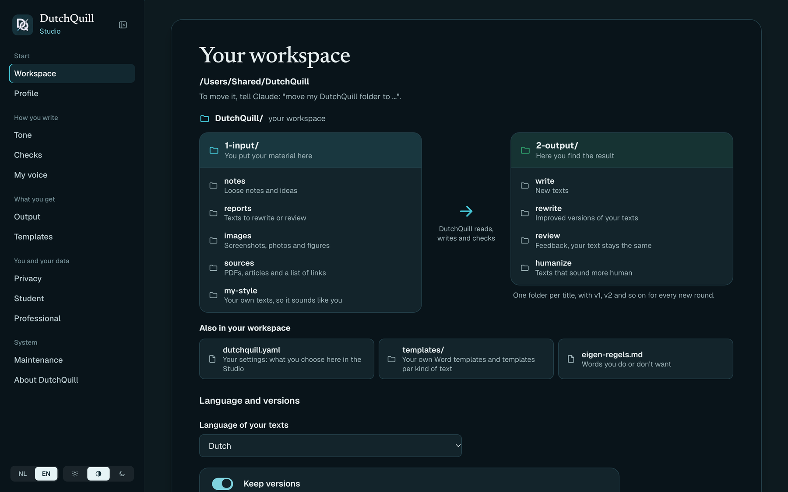
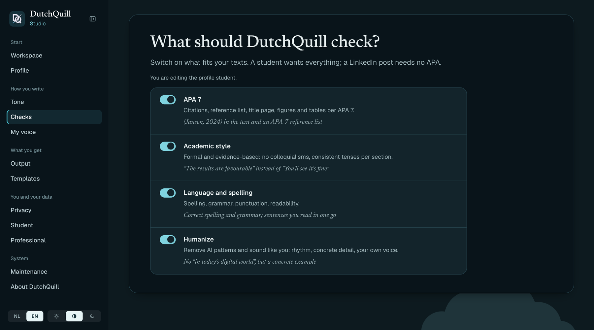
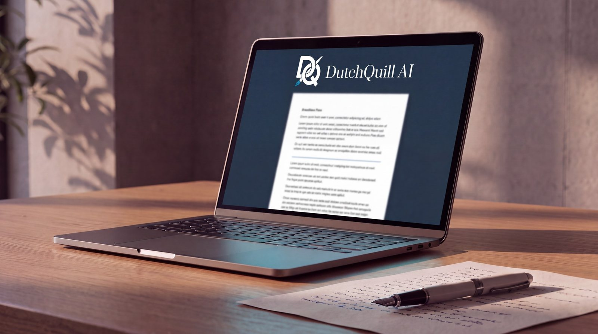

<p align="center"></p>

<p align="center">
  <a href="https://github.com/nickyjacobs/DutchQuill-AI/releases/latest"></a>
  <a href="https://github.com/nickyjacobs/DutchQuill-AI/actions/workflows/ci.yml"></a>
  
  
  <a href="LICENSE"></a>
</p>

<p align="center"><b>Write, rewrite, review and humanize in Claude Code.<br>Dutch first, fully capable in English, in your own voice.</b></p>

<p align="center">
  <a href="#install">Install</a> ·
  <a href="#what-you-can-do">What you can do</a> ·
  <a href="#dutchquill-studio">Studio</a> ·
  <a href="#your-workspace">Workspace</a> ·
  <a href="#humanizing-honestly">Humanizing</a> ·
  <a href="#the-story">The story</a> ·
  <a href="CHANGELOG.md">Changelog</a> ·
  <a href="README.md">Nederlands</a>
</p>

DutchQuill is a writing assistant for Claude Code. It writes, rewrites, reviews and humanizes your texts: an
academic report, a process document, an email, a LinkedIn post or a README. You decide what it checks, how it
sounds and in which format you get it back.

<p align="center"></p>

## Install

In Claude Code (2.1.275 or later):

```text
/plugin marketplace add nickyjacobs/DutchQuill-AI
/plugin install dutchquill@dutchquill
```

Then type `/dutchquill:instellen` ("set up"). You choose: DutchQuill Studio in your browser (a local page, nothing
goes to the internet), or a few questions in the chat. The first time, DutchQuill installs its Python packages in
the plugin's data folder; that takes about a minute.

**Needed:** Python 3.10 or later, or [uv](https://docs.astral.sh/uv/). **For PDFs:** LibreOffice (best result), or
Google Chrome or Microsoft Edge. Without those, DutchQuill makes a simple PDF. `dq doctor` tells you which route
it uses.

## What you can do

The commands have Dutch names; plain English works just as well.

| Command | What it does |
|---|---|
| `/dutchquill:schrijven` | Write a new text, from your question or the material in your workspace |
| `/dutchquill:herschrijven` | Improve, shorten, make more formal or lighter, translate NL↔EN, without changing a single fact |
| `/dutchquill:reviewen` | Check language, structure, tone, AI patterns and (when switched on) APA and your course rubric |
| `/dutchquill:humaniseren` | Remove AI patterns, in your own voice; or just scan |
| `/dutchquill:instellen` | Workspace, profiles, checks, tone, templates and privacy, visually or in the chat |
| `/dutchquill:bijwerken` | Check the reference guides against their sources (you get a reminder once a month) |

You don't need to remember the commands. "Write an email to Sam saying I'll start later on Friday" or "does this
sound like AI?" works too.

**Emails, posts and short texts** simply appear in the chat. **Documents** go to your workspace, per title and per
version, in the formats you choose: Word, PDF, Markdown, text or HTML.

<picture>
  <source media="(prefers-color-scheme: dark)" srcset="docs/img/zo-werkt-het-en-donker.png">
  
</picture>

## DutchQuill Studio

`/dutchquill:instellen` can open DutchQuill Studio: a page in your browser that only runs on your own computer.
There you choose your workspace, profile, tone, checks, output and templates, without a single line of YAML. Light
or dark, Dutch or English. Nothing is saved before you have seen the overview of your changes.

<p align="center">
  
  
</p>

## Your workspace

One folder for everything, wherever you like: the desktop, Documents, or an Obsidian vault. With English as your
language, the folders get English names.

```text
DutchQuill/
  dutchquill.yaml        your settings (with an explanation per line)
  1-input/
    notes/               raw ideas, notes from lectures or meetings
    reports/             existing or half-finished reports
    images/              screenshots, images, infographics
    sources/             articles and PDFs, or a links.md with URLs
    my-style/            a few texts you wrote yourself
  2-output/
    write/  rewrite/  review/  humanize/
      <title>/v1/  v2/  ...
  templates/             your own Word templates
  eigen-regels.md        words you never (or always) want
```

DutchQuill reads .docx, .pdf (scanned too), .pptx, .xlsx, .csv, .md, .txt, .html and links. Images are prepared
(right orientation, metadata removed) and placed in your document with a caption, in the right spot.

## Profiles and checks

A profile is a starting point:

| Profile | For | Checks | Tone | Output |
|---|---|---|---|---|
| student | academic reports, theses | APA, academic style, language, humanize | formal | docx and pdf, template apa-hbo |
| zakelijk (business) | work documents, reports, emails | language, humanize | business | docx, template zakelijk |
| social | posts and short texts | language, humanize | informal | in the chat |
| techniek (technical) | READMEs, SOPs | language, humanize | neutral | Markdown |

Every check can be switched on or off on its own, the tone has five levels (formal, business, neutral, informal,
light) plus a free field for your own mix, and you can make your own profiles that build on another one:

```yaml
profiel: my-thesis
profielen:
  my-thesis: { basis: student, controles: { humaniseren: false } }
  my-linkedin: { basis: social, toon: { niveau: luchtig, mix: "personal, one concrete example" } }
genre_profielen: { mail: zakelijk, linkedin: my-linkedin }
```

For your emails you fill in your professional details once (name, job title, organisation, contact, closing),
plus a signature or email banner if you like. For the title page of an academic report there are student details.
Everything is described in [docs/configuratie.md](docs/configuratie.md) (Dutch).

<p align="center"></p>

## Templates

Three templates come with the plugin: `apa-hbo` (APA 7, the way Dutch universities of applied sciences want it),
`zakelijk` (business) and `notitie` (note). Add your own house style by putting a .docx in `templates/`.
DutchQuill checks which styles it contains and translates Dutch style names ("Kop 1") by itself. Different
headings or another font? Just say so, or use the Studio: DutchQuill makes an adjusted copy and leaves the original
alone.

Next to the Word templates (how it looks) there is a template per kind of text (what goes in it): twelve in total,
from email and memo to research report and README. Adjust one in the Studio or upload your own version; going back
to the default is always possible.

## Humanizing, honestly

DutchQuill makes text better and more personal:

- your own voice (measured from your texts in `my-style`);
- the AI patterns of 2026, in Dutch and English;
- specific instead of vague;
- a fact check: after every rewrite round it verifies that no number, name, quote or source has disappeared or
  been added. DutchQuill makes nothing up. If something is missing, it says `[source needed]`.

DutchQuill does not promise that a text is "invisible" to AI detectors, and does not change document metadata to
hide anything. If you use AI for a study assignment, follow the rules of your programme. DutchQuill helps you with
the disclosure and the citation (APA, September 2025 format).

**Before (AI):**

> In today's digital world, artificial intelligence plays a crucial role in education. It is not just a tool, but
> a transformative force. In short, the future looks bright.

**After (with a fact from the writer's notes):**

> Since January, students at our school may use AI, as long as they write down what for. Most use it to organise
> sources or to get an explanation of a concept they don't understand.

DutchQuill measures this itself too. This is `dq tells` on exactly these two texts:

<p align="center"></p>

## Privacy

- Your texts stay on your computer and in your conversation with Claude.
- The online language check (LanguageTool) is off by default. Switch it on and your text goes to
  api.languagetool.org.
- `/dutchquill:bijwerken` only fetches public pages (Scribbr NL, Wikipedia, GitHub), and only when you run it.
- DutchQuill Studio only runs on your own computer (127.0.0.1), with a one-time key.

## Guides and sources

The rules come from guides in this repository: APA 7 and Dutch language rules after
[Scribbr NL](https://www.scribbr.nl), citing AI after [APA Style](https://apastyle.apa.org) (September 2025), and
AI patterns after [Wikipedia: Signs of AI writing](https://en.wikipedia.org/wiki/Wikipedia:Signs_of_AI_writing),
[blader/humanizer](https://github.com/blader/humanizer) (MIT) and our own research into Dutch text. The guides
contain rules in our own words, with references.

## From v1 to v2

Version 1 was a folder you opened in Claude Code. Version 2 is a plugin. Bring your old reports and profile details
along by putting them in the new workspace (`1-input/reports/`) and filling in your details with
`/dutchquill:instellen`. What changed: [CHANGELOG.md](CHANGELOG.md) (Dutch).

## The story

<p align="center"></p>

DutchQuill started at university. My reports had to follow APA and meet an academic standard, and I wanted to know exactly what that meant. It turned into quite a rabbit hole. Most people think APA is only about citations, but it also covers your page margins, what your title page looks like, how you add tables, figures and appendices, indenting every paragraph (the first one too) and the hanging indent in your reference list. Then there is the question of what academic writing really is, and how to use AI for it without fooling yourself.

It started with a Word template that got all of that right from the start. Next I had my reports reviewed, and used the feedback to turn them into proper, finished reports.

Then I wanted more. Answering emails faster, writing a LinkedIn post more easily, process documentation for work or the README of a repo, all from rough notes, text and screenshots I had already collected. DutchQuill turns that into a polished result.

At first glance it may look like a tool made by someone who wants everything to be easy. That's partly true 😉 But for me it was mostly a learning project. I now know more about APA than I ever expected; sometimes I knew things about indentation, using appendices the right way and other APA rules that teachers and classmates didn't. I learned how AI generates text, how plagiarism checks work and what good academic writing is. A lot of time went into it, and I am happy to share the result.

*Nicky Jacobs*

## Feedback

DutchQuill is made by one person and gets better from what you run into. A bug or an idea? Open an
[issue](https://github.com/nickyjacobs/DutchQuill-AI/issues/new/choose) or start a
[discussion](https://github.com/nickyjacobs/DutchQuill-AI/discussions), in English or Dutch. Want to build along:
[CONTRIBUTING.md](CONTRIBUTING.md) and [docs/ontwikkelen.md](docs/ontwikkelen.md).

## License

[MIT](LICENSE) © Nicky Jacobs
