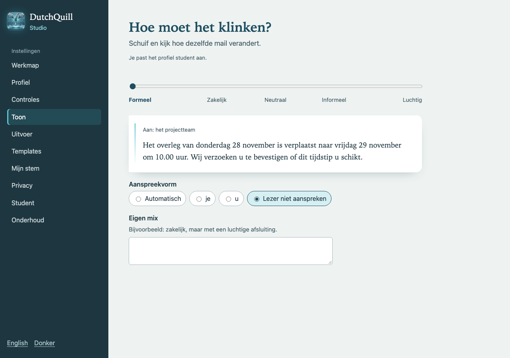

<p align="center">
  <picture>
    <source media="(prefers-color-scheme: dark)" srcset="assets/logo-donker.png">
    
  </picture>
</p>

# DutchQuill AI

   

Een schrijfassistent voor Claude Code, Nederlands eerst en Engels volwaardig. DutchQuill schrijft, herschrijft,
reviewt en humaniseert je teksten: een hbo-rapport, een procesbeschrijving, een mail, een LinkedIn-post of een
README. Jij bepaalt waarop het let, hoe het klinkt en in welke vorm het terugkomt.

*English: see [README.en.md](README.en.md).*



## Installeren

In Claude Code (versie 2.1.275 of nieuwer):

```text
/plugin marketplace add nickyjacobs/DutchQuill-AI
/plugin install dutchquill@dutchquill
```

Typ daarna `/dutchquill:instellen`. Je kiest dan zelf: DutchQuill Studio in je browser (een lokale pagina, er
gaat niets naar internet), of een paar vragen in de chat. De eerste keer installeert DutchQuill zijn
Python-pakketten in de datamap van de plugin; dat duurt ongeveer een minuut.

**Nodig:** Python 3.10 of nieuwer, of [uv](https://docs.astral.sh/uv/). **Voor pdf's:** LibreOffice (beste
resultaat), of Google Chrome of Microsoft Edge. Zonder die programma's maakt DutchQuill een eenvoudige pdf.

## Wat je ermee doet

| Commando | Wat het doet |
|---|---|
| `/dutchquill:schrijven` | Nieuwe tekst schrijven, vanuit je vraag of je materiaal in de werkmap |
| `/dutchquill:herschrijven` | Verbeteren, inkorten, formeler of luchtiger maken, vertalen NL↔EN, zonder dat er een feit verandert |
| `/dutchquill:reviewen` | Nakijken op taal, structuur, toon, AI-patronen en (als dat aan staat) APA en de rubric van je vak |
| `/dutchquill:humaniseren` | AI-patronen eruit, in je eigen stem; of alleen een scan |
| `/dutchquill:instellen` | Werkmap, profielen, controles, toon, templates en privacy, visueel of in de chat |
| `/dutchquill:bijwerken` | De referentiegidsen controleren tegen hun bronnen (je krijgt er één keer per maand een melding voor) |

Je hoeft de commando's niet te onthouden. "Schrijf een mail aan Sanne dat ik vrijdag later begin" of "klinkt dit
als AI?" werkt ook.

**Mails, posts en korte teksten** komen gewoon in de chat. **Documenten** gaan naar je werkmap, per titel en per
versie, in de formaten die je kiest: Word, pdf, Markdown, tekst of html.

## Je werkmap

Eén map voor alles, op de plek die jij kiest: het bureaublad, Documenten, of een Obsidian-vault.

```text
DutchQuill/
  dutchquill.yaml        je instellingen (met uitleg per regel)
  1-input/
    notities/            ruwe ideeën, aantekeningen van colleges of meetings
    rapporten/           bestaande of halve rapporten
    beeld/               screenshots, afbeeldingen, infographics
    bronnen/             artikelen en pdf's, of een links.md met URL's
    mijn-stijl/          een paar teksten die je zelf schreef
  2-output/
    schrijven/  herschrijven/  reviewen/  humaniseren/
      <titel>/v1/  v2/  ...
  templates/             je eigen Word-templates
  eigen-regels.md        woorden die je nooit (of juist wel) wilt
```

DutchQuill leest .docx, .pdf (ook gescand), .pptx, .xlsx, .csv, .md, .txt, .html en links. Beelden worden
klaargemaakt (oriëntatie goed, metadata eruit) en met een bijschrift op de juiste plek in je document gezet.

## Profielen en controles

Een profiel is een startpunt:

| Profiel | Voor | Controles | Toon | Uitvoer |
|---|---|---|---|---|
| student | hbo-rapporten, scripties | APA, academische stijl, taal, humaniseren | formeel | docx en pdf, template apa-hbo |
| zakelijk | werkdocumenten, rapporten, mails | taal, humaniseren | zakelijk | docx, template zakelijk |
| social | posts en korte teksten | taal, humaniseren | informeel | in de chat |
| techniek | README's, SOP's | taal, humaniseren | neutraal | Markdown |

Elke controle staat los aan of uit, de toon heeft vijf niveaus (formeel, zakelijk, neutraal, informeel, luchtig)
plus een vrij veld voor je eigen mix, en je maakt eigen profielen die op een ander profiel voortbouwen:

```yaml
profiel: mijn-scriptie
profielen:
  mijn-scriptie: { basis: student, controles: { humaniseren: false } }
  mijn-linkedin: { basis: social, toon: { niveau: luchtig, mix: "persoonlijk, één concreet voorbeeld" } }
genre_profielen: { mail: zakelijk, linkedin: mijn-linkedin }
```

Alles staat in [docs/configuratie.md](docs/configuratie.md).


## Templates

Drie templates worden meegeleverd: `apa-hbo` (APA 7, zoals een hogeschool het wil), `zakelijk` en `notitie`.
Je eigen huisstijl voeg je toe door een .docx in `templates/` te zetten. DutchQuill controleert welke stijlen
erin zitten en vertaalt Nederlandse stijlnamen ("Kop 1") zelf. Andere koppen of een ander lettertype? Zeg het,
of gebruik de Studio: DutchQuill maakt een aangepaste kopie en laat het origineel staan.

## Humaniseren, eerlijk gezegd

DutchQuill maakt tekst beter en persoonlijker:

- je eigen stem (gemeten aan je teksten in `mijn-stijl`);
- de AI-patronen van 2026 in het Nederlands en het Engels;
- specifiek in plaats van vaag;
- een feitencontrole: na elke herschrijfronde wordt nagegaan dat er geen getal, naam, citaat of bron
  verdwenen of bijgekomen is. DutchQuill verzint niets. Ontbreekt er iets, dan staat er `[bron nodig]`.

DutchQuill belooft niet dat een tekst "onzichtbaar" is voor AI-detectoren, en verandert geen
documentmetadata om iets te verbergen. Gebruik je AI voor een studieopdracht, houd je dan aan de regels van je
opleiding. DutchQuill helpt je met de verantwoording en de bronvermelding (APA, formaat van september 2025).

**Voor (AI):**

> In de huidige digitale wereld speelt kunstmatige intelligentie een cruciale rol in het onderwijs. Het is niet
> alleen een hulpmiddel, maar een transformatieve kracht. Kortom, de toekomst ziet er rooskleurig uit.

**Na (met een gegeven uit de notities van de schrijver):**

> Sinds januari mogen leerlingen op onze school AI gebruiken, als ze opschrijven waarvoor. De meesten gebruiken
> het om bronnen te ordenen of uitleg te krijgen bij een begrip dat ze niet snappen.

## Privacy

- Je teksten blijven op je computer en in je gesprek met Claude.
- De online taalcheck (LanguageTool) staat standaard uit. Zet je hem aan, dan gaat je tekst naar
  api.languagetool.org.
- `/dutchquill:bijwerken` haalt alleen openbare pagina's op (Scribbr NL, Wikipedia, GitHub), en alleen als jij
  het commando geeft.
- DutchQuill Studio draait alleen op je eigen computer (127.0.0.1), met een eenmalige sleutel.

## Gidsen en bronnen

De regels komen uit gidsen in deze repository: APA 7 en taal volgens [Scribbr NL](https://www.scribbr.nl), AI
citeren volgens [APA Style](https://apastyle.apa.org) (september 2025), en AI-patronen volgens
[Wikipedia: Signs of AI writing](https://en.wikipedia.org/wiki/Wikipedia:Signs_of_AI_writing),
[blader/humanizer](https://github.com/blader/humanizer) (MIT) en eigen onderzoek naar Nederlandse tekst. De gidsen
bevatten eigen geformuleerde regels met bronverwijzing.

## Van v1 naar v2

Versie 1 was een map die je opende in Claude Code. Versie 2 is een plugin. Je oude rapporten en profielgegevens
neem je mee door ze in de nieuwe werkmap te zetten (`1-input/rapporten/`) en je gegevens in te vullen via
`/dutchquill:instellen`. Wat er veranderd is: [CHANGELOG.md](CHANGELOG.md).

## Ontwikkelen

Zie [docs/ontwikkelen.md](docs/ontwikkelen.md) en [CONTRIBUTING.md](CONTRIBUTING.md).

## Licentie

MIT. Zie [LICENSE](LICENSE).
