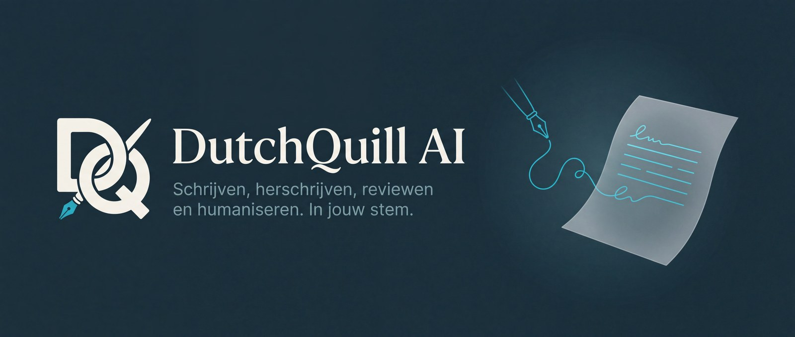
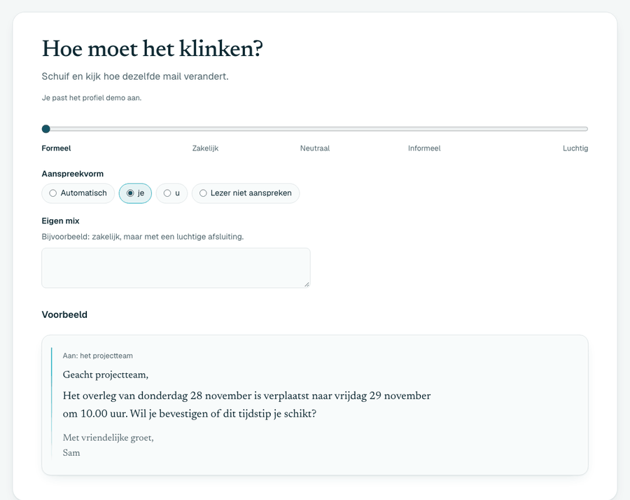
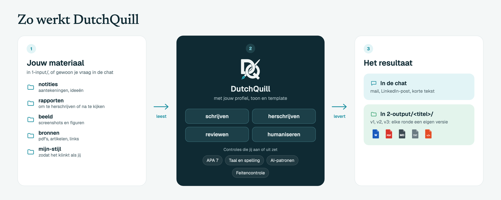
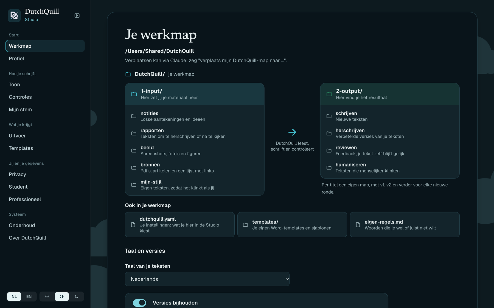
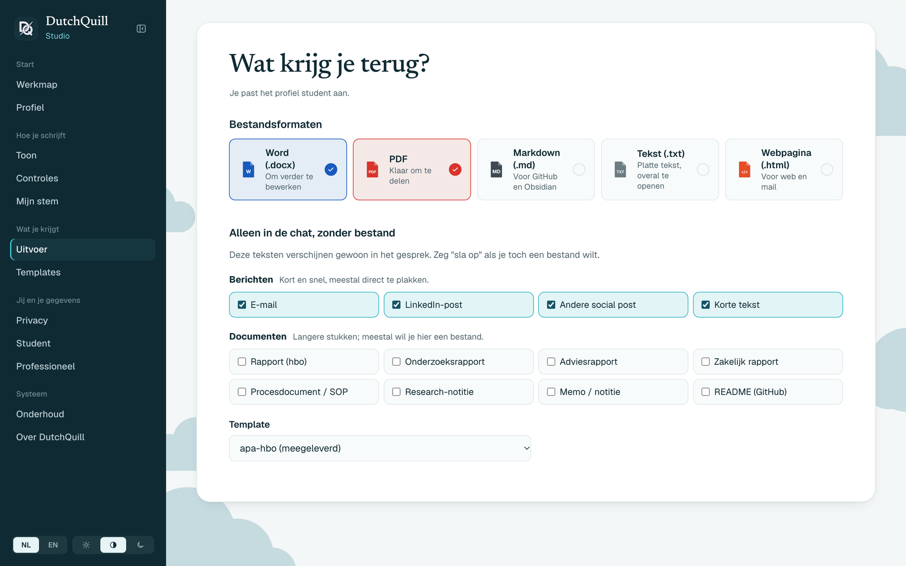
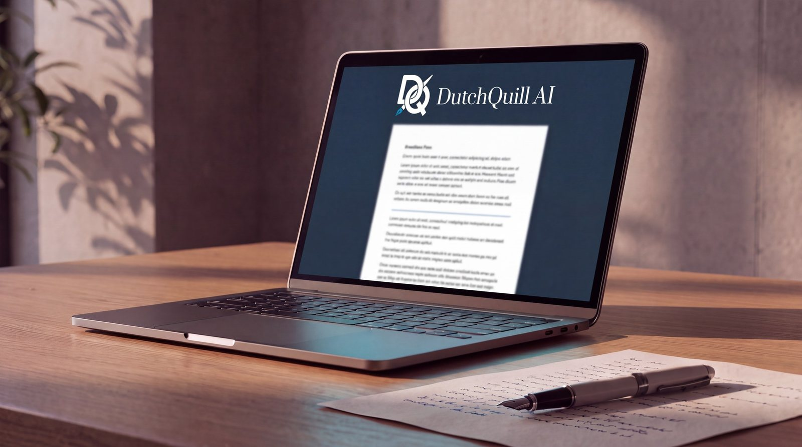

<p align="right"><a href="README.md">🇬🇧 English</a> · <b>🇳🇱 Dutch</b></p>

<p align="center"></p>

<p align="center">
  <a href="https://github.com/nickyjacobs/DutchQuill-AI/releases/latest"></a>
  <a href="https://github.com/nickyjacobs/DutchQuill-AI/actions/workflows/ci.yml"></a>
  
  
  <a href="LICENSE"></a>
</p>

<p align="center"><b>Schrijven, herschrijven, reviewen en humaniseren in Claude Code.<br>Nederlands eerst, Engels volwaardig, in jouw stem.</b></p>

<p align="center">
  <a href="#installeren">Installeren</a> ·
  <a href="#wat-je-ermee-doet">Wat je ermee doet</a> ·
  <a href="#dutchquill-studio">Studio</a> ·
  <a href="#humaniseren-eerlijk-gezegd">Humaniseren</a> ·
  <a href="docs/nl/README.md">Documentatie</a> ·
  <a href="#het-verhaal">Het verhaal</a>
</p>

DutchQuill is een schrijfassistent voor Claude Code. Hij schrijft, herschrijft, reviewt en humaniseert je teksten:
een hbo-rapport, een procesbeschrijving, een mail, een LinkedIn-post of een README. Jij bepaalt waarop hij let, hoe
het klinkt en in welke vorm het terugkomt.

<p align="center"></p>

## Installeren

In Claude Code (versie 2.1.275 of nieuwer):

```text
/plugin marketplace add nickyjacobs/DutchQuill-AI
/plugin install dutchquill@dutchquill
```

Typ daarna `/dutchquill:instellen` en kies: DutchQuill Studio in je browser, of een paar vragen in de chat. Nodig:
Python 3.10 of nieuwer, of [uv](https://docs.astral.sh/uv/). Stap voor stap: [Aan de slag](docs/nl/handleiding/aan-de-slag.md).

## Wat je ermee doet

| Commando | Wat het doet |
|---|---|
| `/dutchquill:schrijven` | Nieuwe tekst schrijven, vanuit je vraag of je materiaal in de werkmap |
| `/dutchquill:herschrijven` | Verbeteren, inkorten, formeler of luchtiger maken, vertalen NL↔EN, zonder dat er een feit verandert |
| `/dutchquill:reviewen` | Nakijken op taal, structuur, toon, AI-patronen en (als dat aan staat) APA en de rubric van je vak |
| `/dutchquill:humaniseren` | AI-patronen eruit, in je eigen stem; of alleen een scan |
| `/dutchquill:instellen` | Werkmap, profielen, controles, toon, templates en privacy, visueel of in de chat |
| `/dutchquill:bijwerken` | De referentiegidsen controleren tegen hun bronnen (één keer per maand krijg je een melding) |

Je hoeft de commando's niet te onthouden: "schrijf een mail aan Sanne dat ik vrijdag later begin" of "klinkt dit
als AI?" werkt ook. Mails en posts komen in de chat; documenten gaan naar je [werkmap](docs/nl/handleiding/werkmap.md),
per titel en per versie, als Word, pdf, Markdown, tekst of html.

<picture>
  <source media="(prefers-color-scheme: dark)" srcset="docs/img/zo-werkt-het-nl-donker.png">
  
</picture>

## DutchQuill Studio

Een pagina in je browser die alleen op je eigen computer draait. Je kiest er je werkmap, profiel, toon, controles,
uitvoer en templates, zonder één regel YAML, en niets wordt opgeslagen voordat je het overzicht hebt gezien.
Meer: [De Studio](docs/nl/handleiding/studio.md).

<p align="center">
  
  
</p>

## Humaniseren, eerlijk gezegd

DutchQuill maakt tekst beter en persoonlijker: in je eigen stem (gemeten aan je eigen teksten), zonder de
AI-patronen van 2026, specifiek in plaats van vaag, en met een feitencontrole na elke ronde zodat er geen getal,
naam of bron verdwijnt of bijkomt. DutchQuill belooft niet dat een tekst "onzichtbaar" is voor AI-detectoren en
verandert geen metadata om iets te verbergen. Meer: [Humaniseren](docs/nl/handleiding/humaniseren.md).

<p align="center"></p>

## Wat DutchQuill draait en ophaalt

- Je teksten blijven op je computer en in je gesprek met Claude.
- Een kleine Python-hook bij de start van een sessie: een eenmalige melding en één herinnering per maand.
- De eerste keer installeert DutchQuill zijn Python-pakketten (PyPI) in de datamap van de plugin.
- De online taalcheck (LanguageTool) staat standaard uit; aan gaat je tekst naar api.languagetool.org.
- `/dutchquill:bijwerken` haalt alleen openbare pagina's op (Scribbr NL, Wikipedia, GitHub), en alleen als jij het
  vraagt. DutchQuill Studio draait op 127.0.0.1, met een eenmalige sleutel.

## Documentatie

Het beginpunt is [docs/README.md](docs/nl/README.md).

- **Handleiding:** [aan de slag](docs/nl/handleiding/aan-de-slag.md), [werkmap](docs/nl/handleiding/werkmap.md),
  [Studio](docs/nl/handleiding/studio.md), [profielen en toon](docs/nl/handleiding/profielen-en-toon.md),
  [templates](docs/nl/handleiding/templates.md), [humaniseren](docs/nl/handleiding/humaniseren.md),
  [vragen](docs/nl/handleiding/vragen.md), [privacy](docs/nl/privacy.md)
- **Naslag:** [configuratie](docs/nl/naslag/configuratie.md), [commando's](docs/nl/naslag/commandos.md),
  [gidsen en bronnen](docs/nl/naslag/gidsen-en-bronnen.md)
- **Project:** [ontwikkelen](docs/nl/project/ontwikkelen.md), [releasen](docs/nl/project/releasen.md),
  [roadmap](ROADMAP.nl.md), [changelog](CHANGELOG.md)

## Het verhaal

<p align="center"></p>

DutchQuill begon op de hogeschool. Mijn rapporten moesten volgens APA en op academisch niveau, en ik wilde precies
weten wat dat betekende. Dat werd een flinke rabbit hole, van marges en titelbladen tot hangende inspringing. Wat
begon als een Word-template, werd een assistent voor alles wat ik schrijf: rapporten, mails, LinkedIn-posts en
README's. Het lijkt misschien een tool voor wie alles makkelijk wil, en deels klopt dat ook 😉 Maar vooral leerde
ik er veel van. [Lees het hele verhaal](docs/nl/verhaal.md).

*Nicky Jacobs*

## Feedback

Een fout of een idee? Open een [issue](https://github.com/nickyjacobs/DutchQuill-AI/issues/new/choose) of start een
[discussie](https://github.com/nickyjacobs/DutchQuill-AI/discussions). Meebouwen: [CONTRIBUTING.md](CONTRIBUTING.md).

## Licentie

[MIT](LICENSE) © Nicky Jacobs
