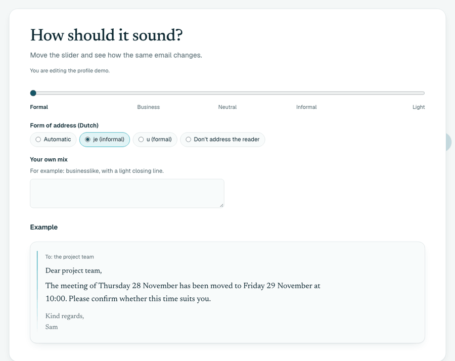
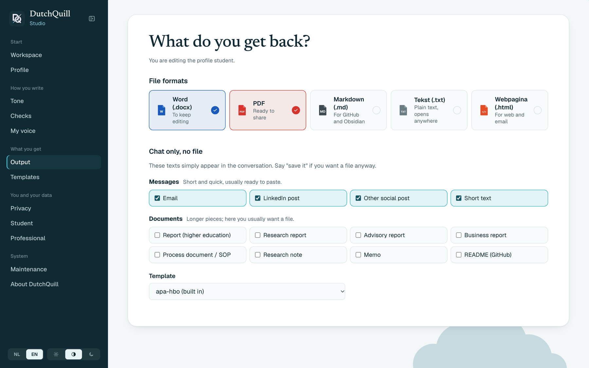

# DutchQuill Studio

The Studio is a page in your browser where you set everything up without typing YAML. Open it with
`/dutchquill:instellen` and choose "visual". It only runs on your own computer (127.0.0.1), with a one-time key in the
link, and stops after "Done" or after fifteen minutes without activity.

Light or dark, Dutch or English: the buttons are at the bottom left. Collapse the menu with the button next to the
logo.

## Saving

Changes are only kept once you save them. A bar at the bottom shows how many changes there are:

- **Review and save** first shows what will change. Then the Studio writes `dutchquill.yaml`, keeping your comments,
  with a `.bak` next to it.
- **Undo changes** puts everything back to the last saved state.

Notifications at the top right say what happened and whether you still need to save. They stay as long as your mouse
is on them. Back in Claude, Claude sees which settings changed.

## The screens

| Group | Screen | What you do there |
|---|---|---|
| Start | Workspace | Where your workspace is (as a picture), the language of your texts, versions on or off |
| | Profile | Pick a profile or make your own; automatically a profile per kind of text |
| How you write | Tone | The tone slider, informal or formal "you" or not addressing the reader, your own mix, with an example email that changes along |
| | Checks | APA, academic style, language and humanizing on or off, with an example per check |
| | My voice | Upload your own texts and measure your voice |
| What you get | Output | File formats, what only appears in the chat, the default template |
| | Templates | Add, check or adjust Word templates; templates per kind of text |
| You and your data | Privacy | The online language check on or off |
| | Student | Details for the title page, courses with their rubric or checklist |
| | Professional | Name, job title, organisation and contact for your emails, plus a signature or email banner |
| System | Maintenance | When the guides were checked, check now, moving clouds on or off |
| | About DutchQuill | Why DutchQuill exists, what the humanizer measures, links |

## Adjusting a built-in profile

The four built-in profiles (student, zakelijk, social, techniek) always stay as they are. If you change something while
one of them is active, the Studio makes your own copy (for example `techniek-eigen`) and makes it active. A
notification tells you so.

## If the Studio doesn't open

- The link contains a key (`#t=...`). Open exactly the link Claude gives you; a bare `127.0.0.1` address won't work.
- If your browser blocks the page, try another browser.
- The Studio stops after fifteen minutes without activity. Type `/dutchquill:instellen` to start it again.
