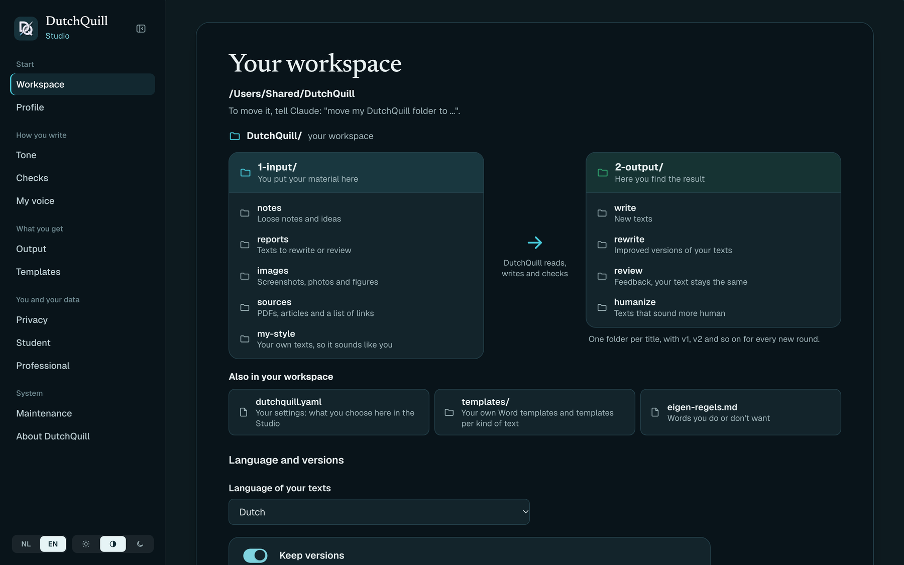

<p align="right"><a href="../../handleiding/werkmap.md">🇳🇱 Nederlands</a> · <b>🇬🇧 English</b></p>

# Your workspace

One folder for everything, wherever you like: the desktop, Documents or an Obsidian vault. The path is stored in the
plugin's data folder; to move it, ask Claude ("move my DutchQuill folder to ...").



## The folders

```text
DutchQuill/
  dutchquill.yaml        your settings (with an explanation per line)
  1-input/
    notes/               rough ideas, notes from lectures or meetings
    reports/             existing or half-finished reports, to rewrite or review
    images/              screenshots, images, infographics
    sources/             articles and PDFs, or a links.md with URLs
    my-style/            a few texts you wrote yourself
  2-output/
    write/  rewrite/  review/  humanize/
      <title>/v1/  v2/  ...
  templates/             your own Word templates and templates per kind of text
  eigen-regels.md        words you never (or always) want, and your house style
```

These are the English folder names, used when you choose English as your language. With Dutch they are `notities`,
`rapporten`, `beeld`, `bronnen`, `mijn-stijl`, `schrijven`, `herschrijven`, `reviewen` and `humaniseren`. You can
also change the names in `dutchquill.yaml`.

## What DutchQuill reads

.docx, .pdf (scanned too: Claude then reads the pages as images), .pptx, .xlsx, .csv, .md, .txt, .html, and links in
a `links.md`. Images are prepared: the orientation is corrected, metadata is removed, and HEIC becomes PNG. In the
document every image gets a caption, in the place where it belongs.

With a lot of material, the subagent `bronnen-lezer` reads everything first and turns it into one summary, with key
points and quotes with page numbers. That keeps the conversation manageable.

For every task DutchQuill shows what is new or changed since last time, and asks which files belong to it.

## Chat or file

| Kind of text | Where it goes |
|---|---|
| Email, LinkedIn post, other social post, short text | In the chat. Say "save it" if you want a file anyway. |
| Report, research or advisory report, SOP, research note, memo, README | In `2-output/<action>/<title>/vN/` |

A README in a repository is a proposal: DutchQuill only overwrites the file after you agree. What goes to the chat is
set under **Output** in the Studio.

## Versions

Every round on the same text gets its own folder: `v1`, `v2`, `v3`. Every version folder holds:

- the document in the formats you chose (Word, PDF, Markdown, text, HTML);
- `bron.md`, the Markdown source all formats are made from;
- `wat-is-er-veranderd.md`: what was done, with which settings, and what you still need to fill in;
- when rewriting, also `origineel.md`, the original.

When you build on an earlier version ("make the introduction shorter"), the new round goes into the same folder as
the previous one, in the same formats. A review always stands on its own, in `review/`. You can switch versions off
under **Workspace** in the Studio; then `v1` is overwritten every time.

The history of all your tasks is in `.dutchquill/historie.jsonl` in your workspace.
