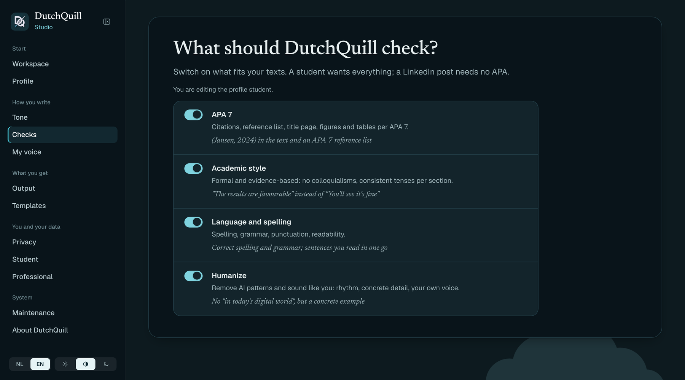

<p align="right"><b>🇬🇧 English</b> · <a href="../nl/handleiding/profielen-en-toon.md">🇳🇱 Dutch</a></p>

# Profiles, checks and tone

## Profiles

A profile is a starting point for all settings at once. The names are Dutch:

| Profile | For | Checks | Tone | Output |
|---|---|---|---|---|
| student | academic reports, theses | APA, academic style, language, humanize | formal | docx and pdf, template apa-hbo |
| zakelijk (business) | work documents, reports, emails | language, humanize | business | docx, template zakelijk |
| social | posts and short texts | language, humanize | informal | in the chat |
| techniek (technical) | READMEs, SOPs | language, humanize | neutral | Markdown |

Switch in the Studio, with `/dutchquill:instellen`, or in your question ("use the social profile").

## Your own profiles

Your own profile builds on another one with `basis` and only sets what differs:

```yaml
profiel: my-thesis
profielen:
  my-thesis: { basis: student, controles: { humaniseren: false } }
  my-linkedin: { basis: social, toon: { niveau: luchtig, mix: "personal, one concrete example" } }
genre_profielen: { mail: zakelijk, linkedin: my-linkedin }
```

With `genre_profielen` DutchQuill automatically picks a profile per kind of text: an email is then always business,
even while you're working on your thesis.

## Checks

| Check | What it does |
|---|---|
| APA 7 | Citations, reference list, title page, figures and tables according to APA 7 (Scribbr NL) |
| Academic style | Formal and well-founded: no colloquial language, no I/you, the right tense per chapter |
| Language | Spelling, verb endings, capitals, commas, compounds, readability |
| Humanize | Remove AI patterns and sound like you: see [Humanizing](humanizing.md) |

Every check can be switched on or off on its own. You can also do it per task: "without APA".



## Tone

The tone has five levels: formal, business, neutral, informal and light. You also choose the form of address (the
informal "je", the formal "u", automatic, or not addressing the reader) and can describe your own mix, such as
"business, but with a light closing line". The Studio shows with an example email how each level sounds.

What each level means exactly (sentence length, colloquial language, emoji, humour) is in the tone guide,
`gidsen/toon.md`.

## Details for your texts

- **Professional:** name, job title, organisation, department, phone, email, website, LinkedIn and a closing.
  DutchQuill uses them to sign off business emails. A signature or email banner (an image) goes in your email app;
  DutchQuill mentions it when writing.
- **Student:** name, student number, institution, faculty and programme for the title page, your level (mbo,
  hbo bachelor or hbo master: how much theory and justification a report gets), and per course the
  checklist or rubric. A review then also checks your report against it. With one course in your profile the
  review loads its criteria by itself; with more it asks which course the text is for. It ends with a verdict
  (ready to submit, minor changes, or rewrite recommended) and, for the checklist, a mark per item and "X of Y met".
  Before writing a report, DutchQuill shows the details it will put on the title page and asks whether they are
  right for this report.

Everything is optional. The full list of settings: [Configuration](../reference/configuration.md).
