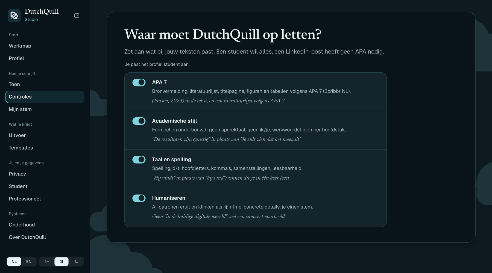

<p align="right"><a href="../../guide/profiles-and-tone.md">🇬🇧 English</a> · <b>🇳🇱 Dutch</b></p>

# Profielen, controles en toon

## Profielen

Een profiel is een startpunt voor alle instellingen tegelijk:

| Profiel | Voor | Controles | Toon | Uitvoer |
|---|---|---|---|---|
| student | hbo-rapporten, scripties | APA, academische stijl, taal, humaniseren | formeel | docx en pdf, template apa-hbo |
| zakelijk | werkdocumenten, rapporten, mails | taal, humaniseren | zakelijk | docx, template zakelijk |
| social | posts en korte teksten | taal, humaniseren | informeel | in de chat |
| techniek | README's, SOP's | taal, humaniseren | neutraal | Markdown |

Wisselen kan in de Studio, met `/dutchquill:instellen`, of in je vraag ("gebruik profiel social").

## Eigen profielen

Een eigen profiel bouwt voort op een ander profiel met `basis` en zet alleen wat anders moet:

```yaml
profiel: mijn-scriptie
profielen:
  mijn-scriptie: { basis: student, controles: { humaniseren: false } }
  mijn-linkedin: { basis: social, toon: { niveau: luchtig, mix: "persoonlijk, één concreet voorbeeld" } }
genre_profielen: { mail: zakelijk, linkedin: mijn-linkedin }
```

Met `genre_profielen` kiest DutchQuill automatisch een profiel per soort tekst: een mail is dan altijd zakelijk,
ook als je net aan je scriptie werkt.

## Controles

| Controle | Wat het doet |
|---|---|
| APA 7 | Bronvermelding, literatuurlijst, titelpagina, figuren en tabellen volgens APA 7 (Scribbr NL) |
| Academische stijl | Formeel en onderbouwd: geen spreektaal, geen ik/je, de juiste werkwoordstijd per hoofdstuk |
| Taal en spelling | Spelling, d/t, hoofdletters, komma's, samenstellingen, leesbaarheid |
| Humaniseren | AI-patronen eruit en klinken als jij: zie [Humaniseren](humaniseren.md) |

Elke controle staat los aan of uit. In je vraag kan het ook per keer: "zonder APA".



## Toon

De toon heeft vijf niveaus: formeel, zakelijk, neutraal, informeel en luchtig. Daarnaast kies je de aanspreekvorm
(je, u, automatisch, of de lezer niet aanspreken) en kun je een eigen mix beschrijven, zoals "zakelijk, maar met
een luchtige afsluiting". De Studio laat met een voorbeeldmail zien hoe elk niveau klinkt.

Wat elk niveau precies betekent (zinslengte, spreektaal, emoji, humor) staat in de toongids, `gidsen/toon.md`.

## Gegevens voor je teksten

- **Professioneel:** naam, functie, organisatie, afdeling, telefoon, e-mail, website, LinkedIn en een
  afsluitende groet. DutchQuill gebruikt ze voor de afsluiting van zakelijke mails. Een handtekening of mailbanner
  (een afbeelding) zet je in je mailprogramma; DutchQuill noemt hem bij het schrijven.
- **Student:** naam, studentnummer, instelling, faculteit en opleiding voor de titelpagina, en per vak de
  checklist of rubric. Bij een review wordt je rapport daar ook op beoordeeld. Staat er één vak in je profiel, dan
  laadt de review de criteria vanzelf; bij meer vakken vraagt hij om welk vak het gaat. Hij eindigt met een oordeel
  (klaar voor inlevering, kleine aanpassingen of herschrijven aanbevolen) en bij de checklist een teken per punt en
  "X van Y voldaan".

Alles is optioneel. De volledige lijst met instellingen: [Configuratie](../naslag/configuratie.md).
