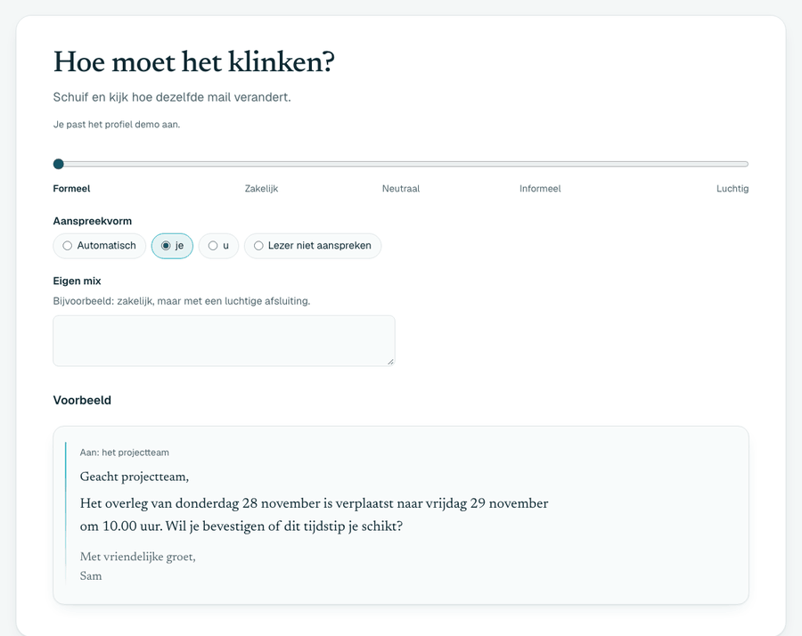
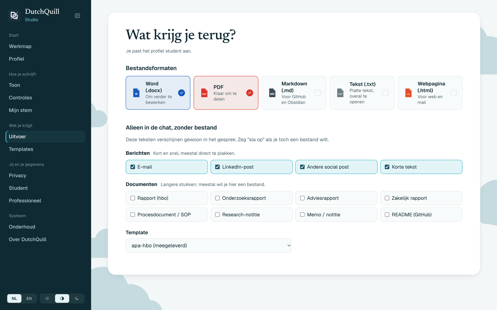

<a href="../../guide/studio.md">🇬🇧 English</a> · <b>🇳🇱 Dutch</b>

# DutchQuill Studio

De Studio is een pagina in je browser waarin je alles instelt zonder YAML te typen. Je opent hem met
`/dutchquill:instellen` en kiest dan "visueel". Hij draait alleen op je eigen computer (127.0.0.1), met een
eenmalige sleutel in de link, en stopt na "Klaar" of na een kwartier zonder activiteit.

Licht of donker, Nederlands of Engels: de knoppen staan linksonder. Het menu klap je in met de knop naast het
logo.

## Opslaan

Wijzigingen worden pas bewaard als je ze opslaat. Onderaan verschijnt een balk met het aantal wijzigingen:

- **Bekijken en opslaan** laat eerst zien wat er verandert. Daarna schrijft de Studio `dutchquill.yaml`, met je
  commentaar erin en een `.bak` ernaast.
- **Terugdraaien** zet alles terug naar de laatst opgeslagen stand.

Meldingen rechtsboven zeggen wat er gebeurde en of je nog moet opslaan. Ze blijven staan zolang je muis erop
staat. Terug in Claude ziet Claude welke instellingen er veranderd zijn.

## De schermen

| Groep | Scherm | Wat je er doet |
|---|---|---|
| Start | Werkmap | De plek van je werkmap (als plaatje), de taal van je teksten, versies aan of uit |
| | Profiel | Een profiel kiezen of een eigen profiel maken; automatisch een profiel per soort tekst |
| Hoe je schrijft | Toon | De toonschaal, je/u of de lezer niet aanspreken, een eigen mix, met een voorbeeldmail die meeverandert |
| | Controles | APA, academische stijl, taal en humaniseren los aan of uit, met een voorbeeld per controle |
| | Mijn stem | Eigen teksten uploaden en je stem meten |
| Wat je krijgt | Uitvoer | Bestandsformaten, wat alleen in de chat komt, de standaardtemplate |
| | Templates | Word-templates toevoegen, controleren of aanpassen; sjablonen per soort tekst |
| Jij en je gegevens | Privacy | De online taalcheck aan of uit |
| | Student | Gegevens voor de titelpagina, vakken met hun rubric of checklist |
| | Professioneel | Naam, functie, organisatie en contact voor je mails, plus handtekening of mailbanner |
| Systeem | Onderhoud | Wanneer de gidsen gecontroleerd zijn, nu controleren, bewegende wolken aan of uit |
| | Over DutchQuill | Waarom DutchQuill bestaat, wat de humanizer meet, links |

## Een meegeleverd profiel aanpassen

De vier meegeleverde profielen (student, zakelijk, social, techniek) blijven altijd zoals ze zijn. Pas je iets aan
terwijl zo'n profiel actief is, dan maakt de Studio een eigen kopie (bijvoorbeeld `techniek-eigen`) en zet die
actief. Een melding zegt dat.

## Als de Studio niet opent

- De link bevat een sleutel (`#t=...`). Open precies de link die Claude geeft; een kale `127.0.0.1`-adres werkt niet.
- Blokkeert je browser de pagina, probeer dan een andere browser.
- De Studio stopt na een kwartier zonder activiteit. Typ `/dutchquill:instellen` om hem opnieuw te starten.
