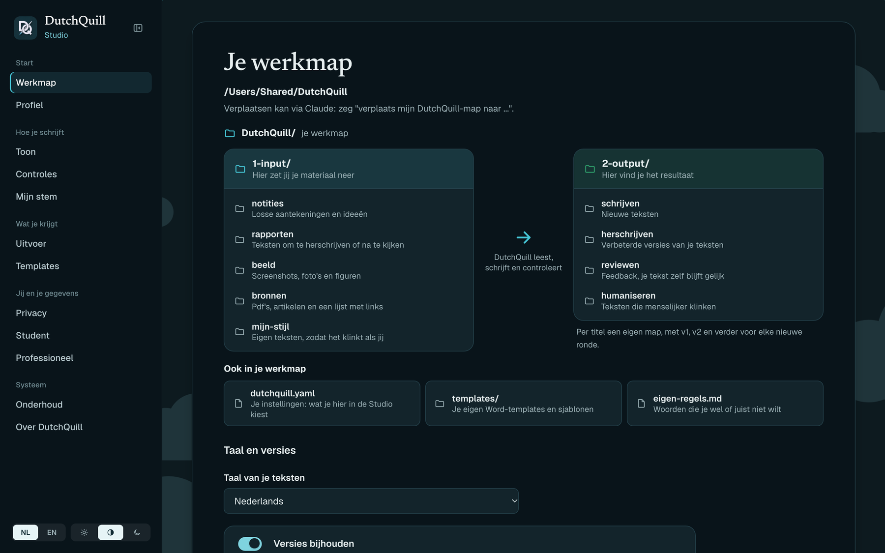

<p align="right"><a href="../../guide/workspace.md">🇬🇧 English</a> · <b>🇳🇱 Dutch</b></p>

# Je werkmap

Eén map voor alles, op de plek die jij kiest: het bureaublad, Documenten of een Obsidian-vault. Het pad staat in
de datamap van de plugin; verplaatsen kan via Claude ("verplaats mijn DutchQuill-map naar ...").



## De mappen

```text
DutchQuill/
  dutchquill.yaml        je instellingen (met uitleg per regel)
  1-input/
    notities/            ruwe ideeën, aantekeningen van colleges of meetings
    rapporten/           bestaande of halve rapporten, om te herschrijven of na te kijken
    beeld/               screenshots, afbeeldingen, infographics
    bronnen/             artikelen en pdf's, of een links.md met URL's
    mijn-stijl/          een paar teksten die je zelf schreef
  2-output/
    schrijven/  herschrijven/  reviewen/  humaniseren/
      <titel>/v1/  v2/  ...
  templates/             je eigen Word-templates en sjablonen per soort tekst
  eigen-regels.md        woorden die je nooit (of juist wel) wilt, en je huisstijl
```

Kies je Engels als taal, dan krijgen de submappen Engelse namen (`notes`, `reports`, `images`, `sources`,
`my-style`, `write`, `rewrite`, `review`, `humanize`). De mapnamen zijn ook aan te passen in `dutchquill.yaml`.

## Wat DutchQuill leest

.docx, .pdf (ook gescand: Claude leest de pagina's dan als beeld), .pptx, .xlsx, .csv, .md, .txt, .html, en links
in een `links.md`. Beelden worden klaargemaakt: de oriëntatie wordt goed gezet, de metadata gaat eruit, en HEIC
wordt PNG. In het document krijgt elk beeld een bijschrift op de plek waar het hoort.

Bij veel materiaal leest de subagent `bronnen-lezer` alles eerst en maakt er één samenvatting van, met
kernpunten en citaten met paginanummer. Zo blijft het gesprek overzichtelijk.

Bij elke opdracht laat DutchQuill zien wat er nieuw of gewijzigd is sinds de vorige keer, en vraagt welke
bestanden erbij horen.

## Chat of bestand

| Soort tekst | Waar het komt |
|---|---|
| Mail, LinkedIn-post, andere social post, korte tekst | In de chat. Zeg "sla op" als je toch een bestand wilt. |
| Rapport, onderzoeks- of adviesrapport, SOP, research-notitie, memo, README | In `2-output/<actie>/<titel>/vN/` |

Een README in een repository is een voorstel: DutchQuill overschrijft het bestand pas na je akkoord. Wat in de
chat komt, stel je in bij **Uitvoer** in de Studio.

## Versies

Elke ronde over dezelfde tekst krijgt een eigen map: `v1`, `v2`, `v3`. In elke versiemap staan:

- het document in de formaten die je koos (Word, pdf, Markdown, tekst, html);
- `bron.md`, de Markdown-bron waar alle formaten uit komen;
- `wat-is-er-veranderd.md`: wat er gedaan is, met welke instellingen, en wat je nog moet aanvullen;
- bij herschrijven ook `origineel.md`.

Werk je verder op een eerdere versie ("maak de inleiding korter"), dan komt de nieuwe ronde in dezelfde map als
de vorige, in dezelfde formaten. Een review staat altijd los, in `reviewen/`. Versies uitzetten kan bij
**Werkmap** in de Studio; dan wordt er overschreven.

De geschiedenis van al je opdrachten staat in `.dutchquill/historie.jsonl` in je werkmap.
