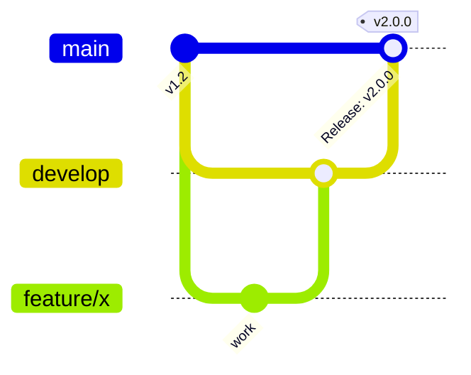

<p align="right"><b>🇬🇧 English</b> · <a href="../nl/project/releasen.md">🇳🇱 Dutch</a></p>

# Releasing

How a new version of DutchQuill comes out. Users install through the marketplace in this repo; a tag `vX.Y.Z` on
`main` is what they see as a version. **A tag is never moved or deleted** (a tag ruleset prevents it).

## Branches

| Branch | What's on it | How something gets there |
|---|---|---|
| `main` | The latest release | Only through a pull request from `develop`, with a merge commit |
| `develop` | What goes into the next release | Through a pull request from `feature/...` or `fix/...` |
| `feature/<name>`, `fix/<name>` | Work in progress | Plain commits |

On `main` and `develop` the checks `test` (Ubuntu, macOS, Windows) and `scan` (gitleaks) are required.



## The CHANGELOG

The CHANGELOG is in English only. At the top a table with one row per release. Then `## [Unreleased]`, and per
version:

```markdown
## [2.1.0] - 2026-12-15

> **In short:** one sentence.

### 🧭 For you           what a user notices or has to do, in plain words
### ✨ Added
### 🔧 Changed
### 🐛 Fixed
### 🗑️ Removed
### 🔒 Security          in this order; leave out empty sections
```

Separate blocks with `---`. The links are at the bottom (`[2.1.0]: .../compare/v2.0.0...v2.1.0`). The release check
verifies all of this.

## Steps

1. **On `develop`:** set the version in three places: `.claude-plugin/plugin.json`, `scripts/dutchquill/__init__.py`
   and `pyproject.toml`. Turn `[Unreleased]` into a version block with a date, add the table row and the links, and
   leave an empty `[Unreleased]`.
2. **Check:**

   ```bash
   uv run --script scripts/dev/release_check.py
   uv run --no-project --python 3.12 --with-requirements requirements.txt --with pytest pytest -q
   claude plugin validate .
   claude plugin eval . --runs 3 --model sonnet --allow-tools Bash --no-publish
   ```

3. **Pull request** from `develop` to `main`, titled `Release: vX.Y.Z`. Merge with a merge commit once the checks are
   green.
4. **Tag** on `main`:

   ```bash
   git checkout main && git pull
   git tag -a vX.Y.Z -m "DutchQuill AI vX.Y.Z"
   git push origin vX.Y.Z
   ```

   The `release` workflow checks that the tag is on `main` and matches the CHANGELOG, and creates the GitHub release
   with the CHANGELOG block as its text.
5. **Back to `develop`:** after a regular release there is nothing to do: the only difference is the merge commit,
   and GitHub doesn't open a pull request for that. If a hotfix went straight to `main`, open a pull request from
   `main` to `develop` and merge it with a merge commit.
