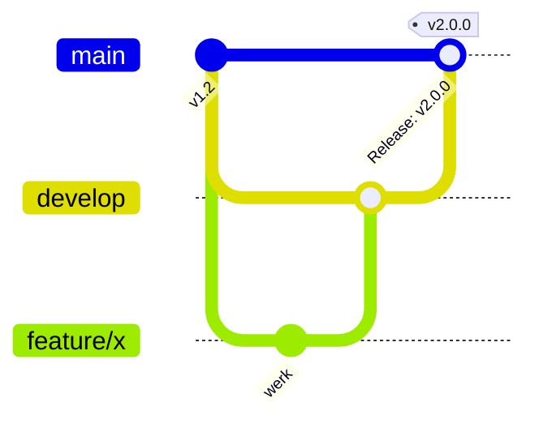

# Releasen

Hoe een nieuwe versie van DutchQuill uitkomt. Gebruikers installeren via de marketplace in deze repo; een tag
`vX.Y.Z` op `main` is wat zij als versie zien. **Een tag wordt nooit verplaatst of verwijderd** (een tag-ruleset
houdt dat tegen).

## Branches

| Branch | Wat erop staat | Hoe er iets op komt |
|---|---|---|
| `main` | De laatste release | Alleen via een pull request vanaf `develop`, met een merge-commit |
| `develop` | Wat in de volgende release komt | Via een pull request vanaf `feature/...` of `fix/...` |
| `feature/<naam>`, `fix/<naam>` | Werk in uitvoering | Gewoon committen |

Op `main` en `develop` zijn de checks `test` (Ubuntu, macOS, Windows) en `scan` (gitleaks) verplicht.



## De CHANGELOG

Bovenaan een tabel met één regel per release. Daarna `## [Unreleased]`, en per versie:

```markdown
## [2.1.0] - 2026-12-15

> **Kort gezegd:** één zin.

### 🧭 Voor jou          wat een gebruiker merkt of moet doen, in gewone taal
### ✨ Nieuw
### 🔧 Veranderd
### 🐛 Opgelost
### 🗑️ Verwijderd
### 🔒 Beveiliging       in deze volgorde; lege secties laat je weg
```

Blokken scheid je met `---`. Onderaan staan de links (`[2.1.0]: .../compare/v2.0.0...v2.1.0`). De release-check
controleert dit allemaal.

## Stappen

1. **Op `develop`:** zet de versie op drie plekken gelijk: `.claude-plugin/plugin.json`,
   `scripts/dutchquill/__init__.py` en `pyproject.toml`. Maak van `[Unreleased]` een versieblok met datum, voeg de
   tabelregel en de links toe, en laat een lege `[Unreleased]` staan.
2. **Controleren:**

   ```bash
   uv run --script scripts/dev/release_check.py
   uv run --no-project --python 3.12 --with-requirements requirements.txt --with pytest pytest -q
   claude plugin validate .
   claude plugin eval . --runs 3 --model sonnet --allow-tools Bash --no-publish
   ```

3. **Pull request** van `develop` naar `main`, titel `Release: vX.Y.Z`. Merge met een merge-commit zodra de checks
   groen zijn.
4. **Tag** op `main`:

   ```bash
   git checkout main && git pull
   git tag -a vX.Y.Z -m "DutchQuill AI vX.Y.Z"
   git push origin vX.Y.Z
   ```

   De workflow `release` controleert dat de tag op `main` staat en bij de CHANGELOG past, en maakt de
   GitHub-release met het blok uit de CHANGELOG als tekst.
5. **Terug naar `develop`:** `git checkout develop && git merge main && git push`, zodat de merge-commit ook op
   `develop` staat.
