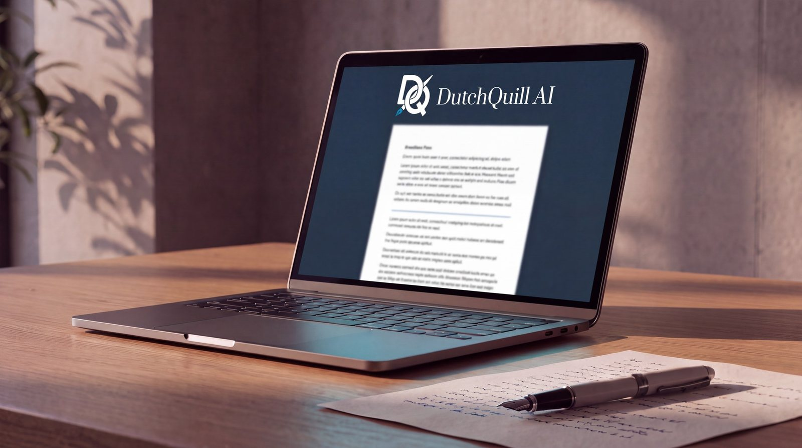

<b>🇬🇧 English</b> · <a href="nl/verhaal.md">🇳🇱 Dutch</a>

# The story

DutchQuill started at university. My reports had to follow APA and meet an academic standard, and I wanted to know exactly what that meant. It turned into quite a rabbit hole. Most people think APA is only about citations, but it also covers your page margins, what your title page looks like, how you add tables, figures and appendices, indenting every paragraph (the first one too) and the hanging indent in your reference list. Then there is the question of what academic writing really is, and how to use AI for it without fooling yourself.

It started with a Word template that got all of that right from the start. Next I had my reports reviewed, and used the feedback to turn them into proper, finished reports.

Then I wanted more. Answering emails faster, writing a LinkedIn post more easily, process documentation for work or the README of a repo, all from rough notes, text and screenshots I had already collected. DutchQuill turns that into a polished result.

At first glance it may look like a tool made by someone who wants everything to be easy. That's partly true 😉 But for me it was mostly a learning project. I now know more about APA than I ever expected; sometimes I knew things about indentation, using appendices the right way and other APA rules that teachers and classmates didn't. I learned how AI generates text, how plagiarism checks work and what good academic writing is. A lot of time went into it, and I am happy to share the result.

*Nicky Jacobs*
