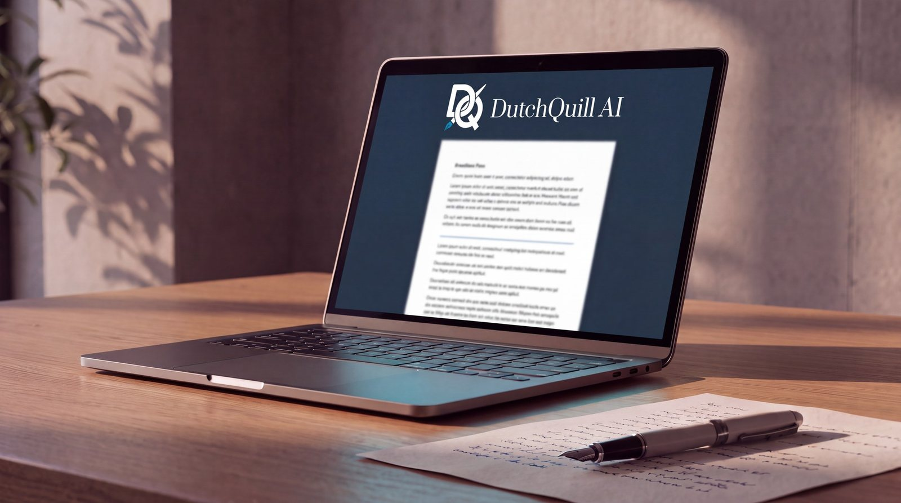

<b>🇳🇱 Nederlands</b> · <a href="en/story.md">🇬🇧 English</a>

# Het verhaal

DutchQuill begon op de hogeschool. Mijn rapporten moesten volgens APA en op academisch niveau, en ik wilde precies weten wat dat betekende. Dat werd een flinke rabbit hole. De meeste mensen denken bij APA alleen aan bronvermelding, maar het gaat ook over de marges van je pagina, hoe je titelblad eruitziet, hoe je tabellen, figuren en bijlagen opneemt, het inspringen van elke alinea (ook de eerste) en de hangende inspringing in je literatuurlijst. En dan heb je nog de vraag wat academisch schrijven echt is, en hoe je AI daarbij gebruikt zonder jezelf voorbij te lopen.

Het begon met een Word-template die alles meteen goed zette. Daarna liet ik mijn rapporten nakijken, en met wat daaruit kwam maakte ik er volwaardige rapporten van.

Toen wilde ik meer. Sneller mails beantwoorden, makkelijker een LinkedIn-post schrijven, procesdocumentatie voor mijn werk of de README van een repo, allemaal vanuit ruwe notities, tekst en screenshots die ik al had verzameld. DutchQuill maakt daar een mooi eindresultaat van.

Op het eerste gezicht lijkt het misschien een tool van iemand die alles makkelijk wil. Deels klopt dat ook wel 😉 Maar voor mij was het vooral een leerproject. Ik weet nu meer over APA dan ik ooit had verwacht; soms wist ik dingen over inspringen, het juiste gebruik van bijlagen en andere APA-regels die docenten en medestudenten ook niet wisten. Ik leerde hoe AI tekst maakt, hoe plagiaatcontrole werkt en wat goed academisch schrijven is. Er zit veel tijd in, en het resultaat deel ik graag.

*Nicky Jacobs*
